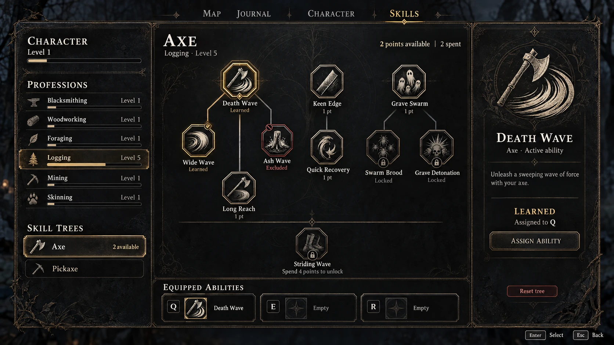

# UI roadmap

This roadmap moves the game's screens and HUD to one shared dark-fantasy style.
It records the accepted decisions and the task sequence. The style itself
(tokens, assets, rules) is in [ui-style-guide.md](ui-style-guide.md).

## Problem

- **No shared style:** every screen typed its own colours and fonts into its
  Widget Blueprints, including the skill screen. There were no UI materials and
  no CommonUI default styles.
- **Crafting:** the screen looked flat and had no fantasy atmosphere. Most of
  its view model data (recipe states, output preview, job state, filters) was
  never shown.
- **Inventory:** `CUI_PlayerInventoryPane` scales down to fit, so it shrinks
  inside the storage and crafting screens. Its cells then differ in size from
  the storage grid next to it.
- **Equipment:** the gear slots had no empty-slot silhouette, label or frame.
- **HUD:** three plain progress bars, of which only health was bound.

## Decisions

| Topic | Decision |
| --- | --- |
| Base style | The skill screen (HARV-09b): subtle, easy to restyle and extend. |
| Mood | An old occult register: blackened iron, bone white and matte old gold. Calm, dark and high-quality, with subtle engravings and clearly readable information. The base colours come from the skill screen concept below. |
| Fonts | Headings in Cinzel (SIL Open Font License, [third-party-notices.md](third-party-notices.md)), body text and numbers in Roboto. KnightsQuest has an unclear licence and is not used in new work. |
| Materials | Subtle procedural UI materials driven by one palette (`MPC_UI_Palette`), restyled through material instance parameters. Seals, locks, diamonds, fine lines and edge scratches are procedural too; there are no filigree textures. The `fantasy_gui_4` marketplace frames are not used. |
| Icons | One engraving material makes the existing icons monochrome in bone white or old gold and dims locked ones. A real engraved icon set can replace the textures later. |
| Inventory | Tarkov-style paper doll and container grids with one cell size everywhere. The standalone inventory shows three columns: equipment, containers and character stats. |
| HUD | After the user's concept (UI-05): vitals with level and XP bottom left, quickbar and Q/E/R bottom centre, menu key hints bottom right. Mana shows only while a pawn has a mana attribute. Groups fade by context so the HUD stays out of the way. |
| Item feedback | After the user's concept (UI-06): framed tooltips and menus, Shift compares with the equipped item, dropping never asks, pickup notifications merge gains of the same item, only rejections raise a toast. |
| Controller support | Wanted later; every task keeps visible focus states, no mouse-only actions and scroll-into-view on focus (see the style guide). |
| Base terminal | Out of scope: it is a leftover of the old inventory whose screen route was removed ([physical-storage-implementation.md](physical-storage-implementation.md)). |

## C++ boundary

- **Classification:** designer-owned presentation on top of existing view
  models. Fonts, palette, materials, styles and layouts are assets.
- **Native work:** read models only where data is missing (UI-01b profession
  icons, UI-03 character stats, UI-04 crafting orders and read models, UI-05 mana,
  UI-06 tooltip comparison, pickup notifications and split), plus test
  updates where tests froze presentation structure.

## Tasks

| ID | Scope | Status |
| --- | --- | --- |
| UI-01 | Style foundation: Cinzel font, palette collection, UI materials, CommonUI text, button and border styles, editor template styles, skill screen as proof, style guide | Done: [#198](https://github.com/Athurito/SurvivalRpg/pull/198) |
| UI-01b | Skill screen after the concept: art set, octagonal plaques with five states, seals and locks, framed panels, detail panel, Q/E/R slots with icon and key, profession icons, menu tab bar and backdrop | Done: [#199](https://github.com/Athurito/SurvivalRpg/pull/199) |
| UI-02 | Tarkov inventory: pane in columns, one shared cell size, new gear and carry slots, storage and crafting hosting, presentation-only test contracts relaxed | Done: [#200](https://github.com/Athurito/SurvivalRpg/pull/200) |
| UI-02b | Gameplay icons: the user's 59-icon package for items, skills, gear glyphs, buildables, upgrades, stats and crafting; icons keep their aspect ratio in fixed boxes; weapon slots turn long weapons | Done: [#201](https://github.com/Athurito/SurvivalRpg/pull/201) |
| UI-02c | Coloured item icons: the user's colour version of the gameplay package replaces the 39 item textures in place; every other icon stays bone white | Done: [#203](https://github.com/Athurito/SurvivalRpg/pull/203) |
| UI-03 | Character stats column (level, XP, load, health, stamina, armour), rarity frames on gear slots, MVVM toolset | Done: [#202](https://github.com/Athurito/SurvivalRpg/pull/202) |
| UI-04 | Crafting screen after the kiln and smithy concepts: category tree, tier sections, preview with stat ranges, one order per station from connected chests into a target chest, per-piece item rolls | Done: [#204](https://github.com/Athurito/SurvivalRpg/pull/204) |
| UI-05 | HUD after the user's concept: vitals and XP, quickbar and Q/E/R, menu key hints, enemy health bar, context fading, mana attribute set | Done: [#206](https://github.com/Athurito/SurvivalRpg/pull/206), vitals cleanup [#208](https://github.com/Athurito/SurvivalRpg/pull/208) |
| UI-06 | Item interactions after the user's concept: tooltip with Shift compare, item action menu, split dialog, pickup notifications, feedback toasts with icons, key caps, item-only highlight; no drop confirmation | Done: [#213](https://github.com/Athurito/SurvivalRpg/pull/213) |
| UI-07 | Menus (game menu tabs, main menu, settings with the controller glyph choice Xbox / PlayStation, respawn), then remove KnightsQuest | Done: settings menu [#216](https://github.com/Athurito/SurvivalRpg/pull/216), game menu, pause menu and respawn [#217](https://github.com/Athurito/SurvivalRpg/pull/217), main menu, load page and font removal [#219](https://github.com/Athurito/SurvivalRpg/pull/219) |
| UI-08 | Inventory layout after Diablo 3: character values left of the equipment, containers below, fewer pocket cells | Planned |

## Noted for later tasks

- **Inventory layout after Diablo 3 (UI-08):** the user's request from
  2026-10-08, with a Diablo 3 inventory as reference.
  - The character values sit directly left of the equipment instead of in a
    third column on the right, where they look out of place. They become more
    compact.
  - The containers move below the equipment.
  - The pockets get fewer cells. Today they are 6 × 6 in
    `DA_PlayerInventoryLayout_Default`; the target size is still open.
  - Open before starting: the pocket size, and what happens to saves. A saved
    item outside the new pocket grid fails the player graph check on load, so
    the world does not load and disk writes stay blocked. Options are
    clearing the pockets in game before the change, starting a new world, or
    a save migration.
  - Storage and crafting host the same pane without the values, so their
    layouts are checked too.

## Open findings outside UI

None. The character XP curve, the last finding here, is now assigned; see
[character-progression.md](character-progression.md). The stats column shows
`XP / next` without UI changes.

## Style foundation (UI-01)

- **Assets:** the palette, materials, fonts and styles listed in the style
  guide, under `Content/SurvivalRpg/UI/Styles` and
  `Content/SurvivalRpg/UI/Fonts/Cinzel`.
- **Editor defaults:** `Config/DefaultEditor.ini` sets the CommonUI template
  styles, so newly placed text blocks, buttons and borders start with the
  shared Body, Default and Panel styles.
- **Skill screen:** `CUI_Skills`, `CUI_SkillTreeNode`, `CUI_TradeSkillEntry`
  and `CUI_SkillTreeListEntry` now use the shared text styles and material
  brushes. Their layout and graphs are unchanged.
  - The node keeps `SetBackgroundColor` per state. Its brushes come from the
    tinted frame instances, which use a dark neutral fill, so each state colour
    reads as a dark tone of itself.
  - The grid links use the palette colours.
- **Palette at runtime:** the palette is a material parameter collection, so a
  later system (for example corruption) can recolour every UI material at
  runtime. A PIE test changed two palette colours and the skill screen followed
  at once.

## Skill screen concept (UI-01b)

The user's concept (2026-10-07) is the target for the skill screen and the
reference for every later screen. Priority: first unify colours and materials
(done in UI-01), then icons and readability, then the detail panel, ability
slots and animations.

- **Colours:**
  - background charcoal `#101214`, panels matte iron `#1B1D20`;
  - text bone white `#DDD4C2`, secondary text warm ash `#A39D92`;
  - learned and accents matte old gold `#AD915A`;
  - exclusions and warnings muted blood red `#824747`;
  - scratches, soot and ornaments mainly at the edges, calm surfaces behind
    text.
- **Nodes:** uniform octagonal metal plaques with engraved symbols. States
  differ in colour, sign and label:
  - learned: gold frame and a small seal;
  - learnable: light edge, clear icon and point cost;
  - locked: dimmed icon, lock and the readable prerequisite;
  - excluded: broken seal in subtle red;
  - selected: an extra outer focus frame.
- **Icons:** one set in engraving or woodcut style, with clear silhouettes,
  equal stroke width, few colours and the same detail density.
- **Tree:** generous spacing and unambiguous links that look like fine inlaid
  channels; unlocked links get a gold accent. Advanced tiers sit behind subtle
  tier dividers with readable prerequisites.
- **Layout:** serif headings and important names, a calm readable font for
  descriptions, values and hints.
  - Left: character, professions, skill tree selection.
  - Middle: the tree.
  - Right: details of the selected ability.
- **Navigation and slots:**
  - Active menu entries get gold text and a fine marker.
  - Q/E/R are three compact slots with the ability icon, its name and a
    separate key badge.
  - Input hints follow the active input device.
- **Animations:** short and subtle:
  - edges brighten on selection;
  - a light pulse runs along unlocked links;
  - a seal is stamped when a node is learned.

### Implementation (UI-01b)

- **Art set:** the user's generated art lives in `Content/SurvivalRpg/UI/Art`
  ([third-party-notices.md](third-party-notices.md)):
  - icons for skills, professions, skill tree categories, crafting and
    navigation;
  - panel, tooltip and slot frames, plus button, tab, progress and divider
    controls;
  - two ornaments and two backgrounds.
  - Icons are 512 px. Frames are trimmed to their visible band and at most
    1024 px. All are imported as UI textures without mips.
  - Skill nodes, both tool trees and all six professions point at the new
    icons. The four remaining pickaxe nodes (Rift Grip, Wide Rift, Deep Grip,
    Steady Hands) got theirs in UI-02b.
- **Profession icons:** `FTradeSkillConfig::Icon`, exposed through
  `URpgTradeSkillProgressionComponent::GetSkillIcon` and
  `URpgTradeSkillViewModel`. This is the only native change.
- **Nodes:** `CUI_SkillTreeNode` is an octagonal plaque, `M_UI_Panel` with
  `Chamfer`. Its state colour only tints the frame and glow
  (`TintFillAmount`).
  - Learned: gold frame and a seal.
  - Learnable: bone frame and the point cost.
  - Unaffordable: ash.
  - Locked: dark frame, dimmed icon, a procedural lock and the prerequisite.
  - Excluded: a blood-red frame and a forbidden sign.
  - The selected node gets an outer ring.
- **Screen:** `CUI_Skills` has three framed panels on the night forest
  backdrop:
  - Left: character, professions with icons, and skill trees; the selected
    tree has a gold frame.
  - Centre: the tree over a faint ritual tree sigil, and the equipped
    abilities. Each Q/E/R slot shows a key badge, the ability icon and its
    name.
  - Right: the detail panel with the icon, name, tree and kind, description,
    state, slot, an Assign Ability button and Reset tree.
- **Assign Ability:** moves the selected learned ability to the first empty
  slot. If it already sits in a slot, it moves to the next one.
- **Menu tabs:** the shared tab styles in
  `Content/SurvivalRpg/UI/Menus/Shared/Modular/TabList` use Cinzel in ash. The
  active tab is gold with an underline marker and a diamond (`M_UI_Glyph` type
  3). This also changes the settings menu tabs.
- **Not done:**
  - Animations: the pulse along unlocked links and the seal stamp on learning.
  - Full gamepad focus styling of the plain node and slot buttons.

## Tarkov inventory (UI-02)

- **One cell size:** every grid uses 56-unit cells with 2 units of padding,
  from the class defaults of `CUI_SpatialInventoryGrid`. The player pane no
  longer sits in a scale box, so its grids keep that size in the inventory,
  storage and crafting screens.
- **Art:** the user's gear package adds equipment glyphs (`Icons/gear`), cell,
  equipment, weapon and container frames, and a paper doll figure
  ([third-party-notices.md](third-party-notices.md)). Slate draws frame
  margins in texture pixels, so the frames are exported at their on-screen
  size ([ui-style-guide.md](ui-style-guide.md#art-set)).
- **Pane (`CUI_PlayerInventoryPane`):** two framed columns and a quick access
  row instead of the fixed canvas.
  - Equipment: the paper doll between the armour slots (head, chest, hands,
    legs, feet) on the left and the off hand and bag slots (backpack, belt,
    pouch, resource bag) on the right. Weapon I and II sit below in wide
    weapon frames. Each slot has a caption.
  - Containers: pockets and every equipped bag, each with a Cinzel title, an
    optional glyph and its grid inside the container frame. A bag's section
    appears only while the bag is equipped. The column scrolls, and a scroll
    box brings the focused grid into view.
  - Quick access: the 1–8 quickbar below both columns.
- **Slots (`CUI_GearSlot`, `CUI_CarrySlot`):**
  - The frame is the CommonUI button style: dim at rest, bright on hover and
    focus.
  - An empty slot shows its glyph; the glyph is set per slot.
  - A ring shows focus, the held source, and valid or invalid drop targets.
  - The weapon or off-hand item in hand glows gold.
- **Cells and items:** cells show the cell frame over an iron fill; the native
  cell states tint the frame with palette colours. Items sit on a lighter
  plate, and stack counts use `CUI_TextStyle_StackCount`. The drag visual's
  state colours follow the palette.
- **Screens:**
  - Inventory (`CUI_PlayerInventory`): the night forest backdrop of the game
    menu, the pane centred, a framed Build Chest button.
  - Storage (`CUI_StorageSpatial`): Inventory and Storage titles that light up
    with the active side, a framed storage column, the storage grid in the
    container frame with a scroll box, and restyled storage controls.
  - Crafting (`CUI_CraftingStationSpatial`): the backdrop and the pane at its
    natural width. The crafting side keeps its scale box until UI-04.
- **Tests:** the content-host test no longer freezes canvas positions,
  parents and child order, and the carry-slot test no longer freezes indicator
  alpha. `CUI_InventorySlotButtonStyle` lost its last users and is retired.
- **Not done:**
  - The character stats column (UI-03).
  - Glyphs for pouch and resource bag; UI-02b adds them.
  - The crafting output grid is still scaled with the crafting side (done in
    UI-04).
  - The quickbar entries keep the HUD look (UI-05).

## Gameplay icons (UI-02b)

- **Art:** the user's package of 59 engraved icons
  ([third-party-notices.md](third-party-notices.md)), 512 px on the long
  edge, imported with mips into `Content/SurvivalRpg/UI/Art/Icons`:
  - `items`: 35 items and 4 dev placeholders (bow, arrows, spell focus, kiln
    kit);
  - `skills`: the four pickaxe nodes;
  - `gear`: pouch and resource bag glyphs, scaled to 256 px like the other
    glyphs;
  - `building`: shared chest, wood storage, Rift Containment and Auto Deposit;
  - `stats`: character values, used by the stats column since UI-03;
  - `crafting`: crafting categories and stations, imported for UI-04 and not
    wired yet.
- **Wiring:**
  - All 43 item definitions (`RpgInventoryFragment_UIData`), the test
    backpack's container icon, and the nine recipes, which show their output
    item.
  - The four pickaxe skill nodes. The ability icons of Rift Grip, Death Wave,
    Grave Swarm and Striding Wave now use the skill icons.
  - Both buildables and both storage upgrades.
  - The pouch and resource bag slots and container headers in
    `CUI_PlayerInventoryPane`.
- **Footprints:** the grid stretches an icon over its footprint, so two items
  now match their art: the basic two-handed sword is 1 × 3 (it was 1 × 1 and
  had no `UIData` fragment, so no icon), and the test sword is 1 × 2 like the
  basic sword.
- **Aspect ratio in fixed boxes:**
  - Gear slots, the HUD quickbar, the quick access wheel and the crafting
    recipe, ingredient, job and selection icons now sit in a `ScaleBox`, and
    their brushes take the texture size.
  - Native: the icon setters of the carry slot, wheel and crafting widgets pass
    `bMatchSize`. The Blueprint `SetSlotIcon` functions of `CUI_GearSlot` and
    `CUI_ActionBarSlotEntry` do the same.
- **Weapon slots:** `URpgInventoryCarrySlotWidget::bTurnPortraitIcons` turns a
  portrait icon a quarter turn. The brush swaps its size, and the inverse
  render scale from `CalculateIconRenderScale` restores the aspect before the
  turn. Weapon I and II enable it, so swords, axes and pickaxes lie across the
  wide frame.

## Coloured item icons (UI-02c)

- **Why:** with every item in bone white, a full backpack read as one pale
  surface, and items were hard to tell apart at a glance.
- **Art:** version 2.0 of the user's gameplay package
  ([third-party-notices.md](third-party-notices.md)) colours the 35 items and
  the 4 dev placeholders in material colours. The engraving style and the
  motifs stay the same:
  - wood and leather brown, iron cool grey, copper warm red, cloth muted olive;
  - plants, berries and meat in natural colours;
  - rift materials and magic foci violet, with a small cyan accent.
- **Import:** the 39 textures in `Icons/items` were re-imported in place with
  the same names, sizes and settings, so no item, recipe or widget reference
  changed.
- **Unchanged:** the other 20 icons of the package (skills, gear glyphs,
  building, stats, crafting) stay bone white; their colour version is
  identical.

## Character stats (UI-03)

- **Column:** `CUI_CharacterStats` is a framed panel like the equipment and
  container columns. It shows:
  - level with the experience bar and text;
  - health and stamina with value and bar;
  - armour;
  - load with its tier, a bar up to the heavy threshold, and kilograms.

  Its icons come from `Icons/stats`; load uses the backpack glyph.
  `CUI_PlayerInventoryPane` hosts it as a third column behind the designer
  variable `bShowCharacterStats`. Only `CUI_PlayerInventory` turns it on;
  storage and crafting keep two columns.
- **Read model:** `URpgCharacterStatsViewModel` mirrors gameplay state:
  - level and experience from `URpgPlayerProgressionComponent`;
  - health, stamina and armour from the pawn's ability system;
  - load and tier from the equipment loadout message.

  It also offers display text and bar fractions, so the widget binds property
  to property. `URpgUiSubsystem` owns one per local player and rebinds it after
  a respawn. Widgets get it through `URpgLocalPlayerViewModelResolver`, which
  `Config/DefaultModelViewViewModel.ini` makes the default resolver. The HUD
  (UI-05) can bind the same instance. `URpgEquipmentLoadoutComponent` exposes
  `GetHeavyLoadThreshold` for the load bar.
- **Rarity frames:**
  - The gear and carry slot view models expose the generated `Rarity` of the
    item, and Common for items without a roll.
  - `CUI_GearSlot` and `CUI_CarrySlot` draw a `RarityRing` inside the frame
    through their `SetRarityRing` function. `MI_UI_RarityRing_Uncommon`,
    `_Rare` and `_Epic` take the palette rarity roles; Common shows no ring.
  - In the weapon slots the ring lies above the gold glow of the weapon in
    hand.
- **MVVM toolset:** the project enables the engine's `MVVMToolset`, so view
  models and property bindings are authored through Unreal MCP; the stats
  column is bound entirely through it. `AssetContractTools` adds the two
  missing pieces: a binding to a widget function (`add_view_function_binding`)
  and a function input of an enum, struct or object type
  (`add_function_input`). The skill reference
  [unreal-mcp-asset-authoring.md](../.agents/skills/unreal-lyra-expert/references/unreal-mcp-asset-authoring.md#widget-blueprint)
  describes them.
- **Not done:**
  - Mana: UI-05 added `URpgManaSet` and the mana fields; no pawn grants the
    set yet.
  - `DA_PlayerProgression` had no `XPToNextLevel` curve, so the experience
    bar stayed empty and the text showed only the experience (for example
    `10 XP`). The curve is progression content and was added later
    ([character-progression.md](character-progression.md)).
  - Items in the grids show no rarity yet; the item tooltip shows it since
    UI-06.

## Crafting screen (UI-04)

The first layout was rejected in review. The user supplied two generated
concepts, the kiln and the smithy. The screen keeps the project's colours,
fonts and styles and takes over the concepts' layout and behaviour. The texts
stay English like the rest of the UI.

### Decisions (2026-10-09)

- **Materials** come only from chests connected to the station. The player
  inventory is no longer a crafting source; construction stays player-first.
- **Output** goes into connected chests. The station tray, Take all,
  auto-deposit and the tray pane are gone.
  - The default target is **Automatic**. Each unit goes into the first chest
    with room, in this order: chests assigned to the exact output, then to its
    category, then unassigned chests already holding it, then other
    unassigned chests.
  - Automatic storing never uses a chest whose assignments do not name the
    output, even if it already holds some, so changed chest assignments steer
    the station instead of filling the wrong chest.
  - A fixed chest stays selectable.
  - A station with a station chest uses that chest as its default target
    instead (follow-up task, see [Station chests](physical-storage-implementation.md#station-chests)).
- **One order per station.** It has a recipe, a quantity up to 99 and a
  target chest. Each piece or run takes its materials when it starts, then
  delivers into the target. A full or missing target and missing materials
  make the order wait; it continues by itself. There is no multi-recipe
  queue.
- **Items with an itemization profile** are rolled per piece: 20 swords are
  20 items with their own values.

### C++ boundary

- **Runtime truth:** the order lives in `URpgCraftingStationComponent`
  (server authority, replicated as `CurrentOrder`, saved). Items live only in
  chest inventories, and itemization state on the item instances.
- **Native:**
  - the order lifecycle;
  - per-piece itemization in the physical batch kernel
    (`ItemizationSourceLevel`, `ItemizationSeed`);
  - the client-safe capacity helper `RpgCraftingCapacity`;
  - the category catalog schema `URpgCraftingCategoryCatalog`;
  - the view models;
  - two generic MVVM list-entry bases, `URpgMvvmListEntryWidget` and
    `URpgMvvmListEntryButton`. They hand the list item to an authored manual
    source, which a Widget Blueprint cannot do generically.
- **Content (Unreal MCP):**
  - the screen and every entry;
  - the catalog data `DA_CraftingCategoryCatalog`;
  - recipe tags and tiers;
  - the station texts (`Presentation`);
  - chests in the test maps;
  - keyboard glyphs.

### Layout (`CUI_CraftingStationSpatial`)

The screen shows only the station on the workshop backdrop.

- **Header:** station icon and name on the left. On the right, "Materials from
  2 connected chests" and the chest names.
- **One framed panel with four columns:**
  1. **Categories:** a list of `CUI_CraftingCategoryRow`.
     - "All recipes", then collapsible groups with subcategories below.
     - Each row has a count.
     - The first click on a group filters it; a second click collapses or
       expands it ("-" / "+").
  2. **Recipes:**
     - title and count, the search field;
     - a tier dropdown and a sort toggle ("Tier ↑/↓");
     - the list, grouped by tier sections (`CUI_CraftingTierSection`, for
       example "II · Iron").
     - Rows show the name and a detail line: "2 per run · 3 s" for stackables,
       "1 × 2 cells" for single items.
  3. **Preview:**
     - breadcrumb, name and item kind ("Single item · individual stats");
     - a 176-unit icon next to the key values (`CUI_CraftingDetailRow`):
       stat ranges at the recipe's item level, or yield, time and stack size;
     - space per item, tier and description;
     - the formula panel ("One run uses 2 Wood → 1 Charcoal");
     - the status with a hint, red when blocked.
  4. **Production:**
     - the material table (Material, Each, In chests);
     - "From connected chests · enough for N runs now";
     - the target dropdown with "Automatic" first, then each connected chest.
       A station chest comes before "Automatic", carries the station icon and
       is selected by default.
       - Chests are named with their assignments, such as "Gemeinsame Kiste
         (Charcoal)".
       - Each row shows free cells and contents ("80 Wood · 12 Ore"); the
         chest that automatic storing fills next is marked.
       - Below the dropdown: the room ("Room for 5 of 5 Charcoal") and either
         the next chest ("Next into …") or the chest's stack details. A fixed
         chest meant for other materials warns ("Assigned to Wood, not to
         Charcoal").
     - quantity −, +, Max;
     - the plan ("20 runs → 40 Charcoal", pure time);
     - the start button, labelled "Start firing" or "Start crafting".
- **Order strip** below the panel:
  - the station's order label and the recipe;
  - status ("Running · 14 s left", "Waiting for materials", "Waiting:
    <chest> full", "Paused");
  - "6 / 20 pieces done" and a progress bar;
  - a hint naming what is missing;
  - Pause or Resume, and Stop remaining.

### Dropdowns and lists

- The tier filter and the target chest are a `URpgCraftingActionButtonWidget`
  over an inline popup with a `CommonListView`:
  - `TierFilterButton` with `TierFilterPopup` and `TierFilterList`
    (`CUI_CraftingTierOption`);
  - `TargetStorageButton` with `TargetStoragePopup` and `TargetStorageList`
    (`CUI_CraftingStorageOption`: name, free cells, contents, and "Next" on
    the chest automatic storing fills next).
- The native screen opens and closes the popups and closes one when the other
  opens or an option is picked. It labels the buttons from the view model.
  This avoids `ComboBoxString`, whose popup sits outside CommonUI input
  routing.
- `RecipeList` takes `TierSectionEntryClass` for section items through
  `OnGetEntryClassForItem`, and `OnIsItemSelectableOrNavigable` keeps the
  sections out of selection and navigation.
- The screen mirrors the view model's category, tier and target choice into
  the list selection, so the chosen row keeps the selected style of
  `CUI_ButtonStyle_ListRow`.
- The native screen forwards the optional `RecipeSearchBox` text to the view
  model.

### Entries

- New entries are Widget Blueprints on the generic bases. Each has one
  optional manual source named in `ViewModelSourceName`:
  - `CUI_CraftingCategoryRow`, `CUI_CraftingTierOption` and
    `CUI_CraftingStorageOption` use the button base;
  - `CUI_CraftingTierSection` and `CUI_CraftingDetailRow` use the widget
    base.
- Small presentation functions in the entries map flags to visuals:
  `ApplyRowKind`, `ApplyExpanded`, `SetEmphasized` and `SetSuggested`.
- Existing entries changed:
  - `CUI_CraftingRecipeEntrySpatial` binds its second line to `DetailText`;
  - `CUI_CraftingIngredientEntrySpatial` shows the cost per unit and colours
    the chest count by `bHasEnoughForOneUnit`.
- Removed: `CUI_CraftingJobEntrySpatial`, `CUI_CraftingCategoryTab` and
  `CUI_CraftingOutputEntrySpatial`.

### Station data

- `FRpgCraftingStationPresentation` on the station component holds the noun,
  start label and order label, for example the kiln's "run/runs", "Start
  firing" and "Firing".
- `DA_CraftingCategoryCatalog` gives names, icons and order to the category
  groups and subcategories (`Crafting.Category.<Group>.`), and names to
  the tiers (I Basic, II Iron).
- Without a catalog entry, the tag's last segment and a roman numeral are
  used.

### Input

- `DT_RpgUIActions_Crafting` has these rows:
  - Start (C, gamepad X);
  - Pause / Resume (P, gamepad Y);
  - Stop remaining (X, gamepad right stick).
- `CommonInputData_Keyboard` gained the C and P glyphs, so these actions show
  their key in the action bar.

### Tests

These replace the old crafting tests:
- order lifecycle (`SurvivalRpg.Crafting.Order.*`);
- batch itemization, stat ranges, capacity and catalog validation;
- view model tests for categories, tier sections and sort, target options, plan
  and preview, and order texts;
- the widget contract, which requires the section entry class, the catalog and
  the stop row.

Take all and tray tests are removed.

### Not done

- **Remote chests:** no "Open" button for chests or the finished items.
  Opening a chest remotely needs an access rule.
- **Header extras:** no gear score, and no base or station names in the
  header.
- **Locked recipes:** no unlock reasons; the recipe data has none.
- **Chest names:** no custom names. Chests show their buildable name
  (currently the German "Gemeinsame Kiste") with their assignments, and a
  number when names repeat.
- **In-world identification:** none. The crafting screen covers the world, so
  highlighting a chest there would not be visible; the dropdown shows
  assignments and contents instead.
- **Station chests:** done in a follow-up task on top of UI-04; see
  [Station chests](physical-storage-implementation.md#station-chests).
- **3D preview:** none; the preview shows the icon.
- **Gamepad focus** across the new popups had only a basic check.
- **Maps without chests:** workbenches in `Lvl_RpgBaseline`,
  `Lvl_ThirdPerson` and `Lvl_LootHarvestSandbox` have no chest nearby, so
  they cannot craft there until chests are placed or built.

## HUD (UI-05)

The user supplied a generated HUD concept: three framed bars with icons
bottom left, the quickbar 1–8 and Q/E/R as one row of square slots bottom
centre, and key hints for menus bottom right. The HUD keeps the project's
colours and styles; texts stay English.

### Decisions (2026-10-10)

- **Arrangement:** vitals bottom left, quickbar and Q/E/R bottom centre, menu
  key hints bottom right, notifications above the slots, the enemy bar above
  the enemy.
- **Vitals:** health (heart), mana (drop) and stamina (runner), each a bar in
  `T_UI_Hud_BarFrame` with the palette bar materials. Health keeps a pale trail
  for a moment after a hit. The concept has no XP, so a thin gold experience
  bar with the level sits under the bars and fades with them.
- **Mana:** `URpgManaSet` (Mana, MaxMana) exists but no pawn grants it. The
  mana row appears by itself once an AbilitySet grants the set.
- **Context fading:**
  - The character is in combat for `HudCombatHoldSeconds` (6 s, project
    setting *RPG UI → HUD*) after taking damage or using an ability its
    equipment grants: attacks, block, weapon and tool abilities. Movement,
    interaction and reactions do not count.
  - The vitals and XP show while in combat or while a vital is not full, and
    for a few seconds after gained experience; otherwise they fade out.
  - The quickbar and Q/E/R dim to 40 % out of combat.
  - The enemy bar appears on a hit and fades 5 s after the last one.
- **Key hints** show only menus that have a key: Tab Inventory and
  H Skills at first; UI-07 added N Character, M Map, J Journal and Esc Menu
  ([Game menu and pause menu](#game-menu-and-pause-menu-ui-07)). A new hint
  is one more entry in `CUI_HudKeyHints`.

### C++ boundary

- **Runtime truth:** vitals and mana live in the ability system, experience in
  the progression component, the hands in the equipment loadout. The HUD only
  reads them.
- **Native:**
  - `URpgManaSet`, replicated and clamped like the stamina set;
  - `URpgCharacterStatsViewModel`: mana fields, `bVitalsFull`, `bInCombat`
    and `bShowVitals`;
  - `URpgActionBarSlotViewModel::bInHand`, resolved from the loadout and
    refreshed on loadout messages;
  - two reusable presentation primitives: `URpgHudFadeBox`, a size box that
    fades its content by pin and pulse, and `URpgTrailingProgressBar`, a
    progress bar whose drops linger and drain. Both keep their timing in
    small Slate-free state structs that tests drive directly.
- **Content (Unreal MCP):** every widget and its bindings, the bar frame
  texture, the Tab key glyph, and Tab ordered before I for the inventory
  action, so the hint names Tab.
- **Removed:** the local-player vitals path that `CUI_PlayerVitalls` no
  longer uses: `UPlayerVitalsViewmodel`, `UPlayerVitalsResolver` and the
  vitals view model of `URpgUiSubsystem`. `UEnemyVitalsViewmodel` now
  mirrors health itself instead of deriving from the player model.

### Widgets

- `CUI_RpgHudLayout`: the extension points sit directly in the safe zone
  (vitals bottom left, action bar bottom centre, notifications above it), and
  `CUI_HudKeyHints` bottom right.
- `CUI_PlayerVitalls`: now binds `URpgCharacterStatsViewModel` instead of the
  old vitals view model. `VitalsFade` is pinned by `bShowVitals` and pulsed
  by `CharacterXP`; `SetManaShown` collapses the mana row without a mana set.
- `CUI_HudBottomBar`: `BarsFade` (hidden opacity 0.4) pinned by `bInCombat`
  around the fixed-width quickbar (8 × 72) and ability bar (3 × 72).
- `CUI_ActionBarSlotEntry` and `CUI_WeaponAbilityBarSlot`: 64-unit slots with
  the gear slot fill, `T_UI_Gear_Frame_Cell`, the key glyph top left and the
  stack count bottom right.
  - The weapon in hand gets a gold ring, the active glow and a diamond below
    (`SetInHand`).
  - An ability on cooldown gets a dark veil and the remaining time from
    `CooldownText` (`SetCooldownActive`).
  - The inventory's quick access row uses the same entry.
- `W_EnemyHealthBarIndicator` (GF_Combat_Core): the vitals bar style at 150 ×
  18 with the trail; `EnemyFade` is pulsed by every health change. Its
  manual source `EnemyVitals` takes the `UEnemyVitalsViewmodel` that
  `URpgEnemyVitalsIndicatorWidget` binds to the hit actor.

### Tests

- `SurvivalRpg.UI.Hud.FadeHoldsThenFades` and
  `SurvivalRpg.UI.Hud.TrailDrainsAfterDelay` drive the fade and trail states.
- `SurvivalRpg.UI.CharacterStats.ManaAndHudContext` covers the mana set, full
  vitals and the combat hold.
- `SurvivalRpg.Inventory.QuickAccess.WeaponSlot1DragCommitsAuthorityBinding`
  checks that the quick access slot of the main-hand weapon reads as in hand.
- The action bar entry pooling test no longer freezes the number of bindings.
- `SurvivalRpg.UI.EnemyVitals.HealthFollowsPawnExtension` follows an enemy's
  health through ability system teardown and re-initialization, and
  `SurvivalRpg.UI.EnemyVitals.IndicatorWidgetTakesViewModel` checks that the
  indicator has exactly one settable source for that view model and binds it.

### Not done

- **Menu keys:** the map, journal, character and pause menus had no working
  key, so the hints showed only Inventory and Skills. UI-07 added them.
- **XP curve:** `DA_PlayerProgression` still had no curve, so the experience
  bar stayed empty. It was added later
  ([character-progression.md](character-progression.md)).
- **Damage dealt** does not start combat by itself; using the weapon does.
- **Boss bars** and enemy names are not part of this task.

## Item interactions (UI-06)

The user supplied a generated concept with four panels: HUD hints
(interaction prompt, pickup notifications, an ability failure), the split
dialog, the item action menu and the item tooltip. The widgets keep the
project's colours and styles; texts stay English.

### Decisions (2026-10-10)

- **No drop confirmation:** a dropped item lies in the world and can be
  picked up again, so dropping never asks. The `Confirm` drop policy and its
  dialog are gone; quest items stay blocked through `Disabled`.
- **Tooltip:** a framed card with the icon, the name, rarity and item level,
  the base stats as large values, the affixes, the description and a
  "Shift Compare" hint.
- **Compare:** while Shift is held, the item equipped in the hovered item's
  default slot appears beside the tooltip, marked "Equipped". Every stat of
  the hovered item shows its difference, green when higher and red when
  lower; a stat the equipped item lacks counts against zero.
- **Item actions:** a framed menu with the item, its count, and one row per
  action with an icon. Drop is red and sits below a divider.
- **Split:** the stack and its total, minus, the amount, plus and Half, a
  slider from 1 to the stack size minus one, "49 split · 50 remain", and
  Cancel and Split with their key caps.
- **Pickup notifications:** only gains from the world (pickups, harvest
  yields, recovered loot). Moves inside the inventory cancel out; gains while
  an inventory, storage or crafting screen is open count as screen moves.
  Gains of the same item add up in one notification while it is shown
  (`HudPickupHoldSeconds`, 4 s, project setting *RPG UI → HUD*), so
  harvesting does not spam "1 × Wood".
- **Feedback:** the inventory toast shows only rejections, in amber with an
  icon; completed moves are visible in the grid. The HUD toast shows an icon
  per failure and, for a missing resource, its fill.
- **Key caps:** one set for keyboard and mouse (dark cap, gold rim, bone
  white label) replaces the white CommonUI defaults everywhere.
- **Icons:** one icon per item action and per feedback kind.
- **Art:** the caps and icons first shipped as generated placeholders. The
  user's input art pack replaced them in place under the same names, so no
  widget changed; only the brush sizes of the caps followed the new aspect
  ratios. The mouse wheel directions and the side buttons gained caps of
  their own.
- **Controller glyphs:** the same pack's Xbox and PS5 glyphs replace the old
  Xbox One glyphs in `CommonInputData_Gamepad` and fill the new
  `CommonInputData_GamepadPS5`. The split dialog's Esc and Enter became
  action glyphs (`UI.Back`, `UI.Accept`), so a gamepad shows B and A there,
  and the HUD key hints size their glyphs by height only.

### C++ boundary

- **Runtime truth:** items live in the player inventory graph, equipment in
  the loadout component, ability failures in GAS. The widgets only read.
- **Native:**
  - removal of the drop confirmation: the `Confirm` policy, the
    `RequiresConfirmation` result, the `bConfirmed` request flag, the dialog
    class and the screen plumbing;
  - `URpgItemTooltipViewModel` and `URpgItemStatRowViewModel`: the tooltip
    read model and the stat comparison; the tooltip widget resolves the
    equipped counterpart, polls Shift (or `SetComparisonPinned`) and hands
    both models to its two authored panels;
  - `URpgPickupFeedViewModel` and its entries: nets the player inventory's
    stack changes per item, suppresses screen moves, restored saves and the
    first replication burst, and merges gains. `URpgUiSubsystem` provides it
    per local player; stack messages carry `bFromRestore`, inventory screens
    send `Rpg.Inventory.Message.ScreenActivation`;
  - `URpgInventorySplitViewModel`, the item header of the context menu, icons
    and destructive styling of action rows, icon and colours of the inventory
    toast, and the cost attribute plus presentation rows of the HUD toast;
  - grid cells under an item no longer draw a cursor frame of their own; the
    item outlines its footprint;
  - two reusable primitives: `URpgViewModelEntryBox`, a non-scrolling box
    that shows one entry per view model and keeps surviving entries, and
    `URpgLazyImage`, a lazy image with a one-argument setter for MVVM.
- **Content (Unreal MCP):** every widget, the bindings, three text styles,
  the key caps, the action and feedback icons, the popup frame, the keyboard
  brush map and the Use / Equip label.

### Widgets

- `CUI_ItemTooltip`: two `CUI_ItemTooltipPanel` cards (`ComparisonPanel`,
  `ItemPanel`). A card binds its manual source `Item`; base stats use
  `CUI_ItemStatColumn` and affixes `CUI_ItemAffixRow` through view-model
  entry boxes. The spatial item, gear slot and carry slot use it.
- `CUI_InventoryContextMenuSpatial`: the framed panel with the header bound
  to `ContextItem`. `CUI_InventoryContextActionEntrySpatial` holds the icon
  per action and the destructive colour as class defaults.
- `CUI_InventorySplitDialogSpatial`: the new layout, bound to `Split`.
- `CUI_InventoryFeedbackToastSpatial` and `CUI_AbilityFailureToast`: amber
  text with an icon; the HUD toast lists its icons and resource bars per
  failure tag (cost with stamina or mana, cost, cooldown, blocked, missing
  tags, harvesting skill level).
- `CUI_HudPickupFeed` and `CUI_HudPickupEntry`: framed notifications on the
  right of the HUD, newest at the bottom; an entry fades out when it expires.
- `CUI_InteractionPrompt`: the framed plate with the key cap and the label
  in the subheading style.
- `CUI_InventoryDragVisual` and `CUI_SpatialInventoryCell`: drag and preview
  colours from the palette.
- `T_UI_Frame_Tooltip`: re-exported at screen size (458 × 207, 18 px
  corners) for every popup.

### Tests

- `SurvivalRpg.Inventory.Drop.AuthorityAndReplay` (renamed from the
  confirmation test) drops a weapon stack directly and keeps the stale,
  oversized, replay and collision checks.
- `SurvivalRpg.Itemization.UI.TooltipComparesWithEquipped`: rows compare
  with the equipped item, against themselves and without a baseline.
- `SurvivalRpg.UI.Hud.PickupFeedNetsMergesAndSuppresses`: netting, merging,
  screen and restore suppression, expiry and the entry limit.
- `SurvivalRpg.UI.Hud.ViewModelEntryBoxKeepsEntries`: surviving entries keep
  their widget, a reorder rebuilds.
- Relaxed presentation freezes: the action widget test no longer requires
  the absence of graphs and MVVM and accepts styled subclasses of the bound
  widget types (`CommonTextBlock` for a text block), and the interaction HUD
  test no longer fixes the key glyph at 24 px.

### Not done

- **PlayStation glyphs:** the Xbox set shows by default. Windows cannot
  tell a DualSense from an Xbox controller over XInput, so the settings menu
  got a glyph choice in UI-07 ([Settings menu](#settings-menu-ui-07)).
- **Controller overview:** moved to the new glyphs in UI-07.
- **Gamepad compare:** `SetComparisonPinned` exists, but no button calls it.
- **Resource fill in the HUD toast:** abilities do not use GAS cost effects
  yet, so no failure names a cost attribute; only the harvesting skill level
  has a user-facing message today.
- **Inspect** still only selects the item.
- **Compare** uses only the hovered item's default equip slot, so a second
  ring or the off hand is not compared.
- **Toasts** show one message at a time instead of a stack.
- The slider shows no gold fill left of the thumb, and hovered menu rows
  show the row highlight without the concept's chevron.

## Settings menu (UI-07)

The first part of UI-07. The user kept the settings menu's layout and asked
for the shared style and the controller glyph choice; there was no concept.
The design is unchanged: tabs Game, Graphic, Audio, Input (gamepad only) and
Controls, one row per setting.

### Behavior

- **Style:** the rows are inset iron plates with a gold frame on hover
  (`MI_UI_Panel_Inset`, `MI_UI_Frame_Row`). Categories are Cinzel headings
  over a faint gold rule instead of grey bars. Labels use the shared text
  styles (strong body for names, number style for slider values).
- **Controls in a row:**
  - the option arrows show the hover and pressed frames;
  - the bars below a value are ash, and the chosen one is gold;
  - the slider is a thin old-gold line with a gold diamond thumb;
  - Auto Set Quality uses the default button frames.
- **Fonts:** KnightsQuest is gone from the settings menu, from the shared
  action bar button (`CUI_ActionButtonBase`, used by every screen's
  Esc Back bar) and from `CUI_SettingDescriptionTextStyle`, which the server
  browser and save slots also use.
- **Gamepad Prompts:** a new *Controller* category in the Game tab offers
  Xbox and PlayStation. The choice applies at once to every CommonUI glyph
  and is saved per user in `GameUserSettings.ini`. The next start applies it
  before any screen shows a prompt.
- **Controller overview** (Input tab, gamepad only):
  - the controller picture and the glyphs follow the chosen set;
  - each glyph is labelled with the gameplay actions on that button, read
    from the input actions' descriptions in the player's mapping contexts;
  - unbound buttons are dimmed.

  It covers move, look, jump, interact, sprint, menu, inventory and quick
  access; LT, RT, RB, the stick presses, B / Circle, Y / Triangle and the
  D-pad except up are unbound on a gamepad today.
- **Graphic tab:** the preview area on the right stays for the planned
  pictures of each graphics setting; it no longer shows the "Text Block"
  placeholder before a setting is hovered.

### C++ boundary

- **Classification:** presentation on existing pages, plus one small native
  mechanism for the glyph choice.
- **Runtime truth:** `UCommonInputSubsystem`'s gamepad name per local
  player. The choice is local presentation; it never replicates and gameplay
  never reads it.
- **Native:** `URpgControllerGlyphSubsystem` (local player subsystem):
  - lists the gamepad glyph sets registered for the platform;
  - sets the chosen one on CommonInput and saves it in
    `GameUserSettings.ini`, applying it again when the local player starts;
  - returns key brushes and the controller picture, which CommonInput does
    not expose to Blueprint.
- **Content (Unreal MCP):** every widget and style, the option row and its
  graph, the overview graphs, the display name *Xbox* and the controller
  pictures on the controller data (`ControllerTexture`), and English
  descriptions on the described input actions.
- **PS5 picture:** `PS5_Diagram_Overview` places the existing PS5 line
  drawing at the Xbox picture's size and position, so both fill the overview
  the same way. It has no leader lines: the PS5 D-pad sits above the left
  stick, so lines to the fixed callout rows would cross.

### Tests

- `SurvivalRpg.UI.Input.GamepadGlyphOptions`: the platform offers more than
  one glyph set, including its default gamepad, each named once with a
  player-facing name and a face button glyph; unknown names are rejected.
- `SurvivalRpg.UI.Input.PlayerInventoryNativeTag` expects the Tab key that
  UI-05 added to the inventory action, so the suite passes again.

### Not done

- **Key rebinding:** the Controls tab is empty. Its list only reads
  `IMC_UI_PlayerHUD`, and no mapping there is marked player-mappable;
  rebinding needs a decision on which actions players may rebind.
- **Gamepad bindings:** attacks, block, abilities and most menus have no
  gamepad keys yet, so the overview shows them unbound.
- **Graphics previews:** the hover pictures are still placeholder key
  textures from `UI/Menus/Shared/Platform/Keyboard___Mouse`.
- **Inventory:** the build button at the top right of the inventory still
  reads "Kiste bauen".

## Game menu and pause menu (UI-07)

The second part of UI-07. There was no concept; the pages use the panels,
frames and text styles of the skill screen.

### Decisions (2026-10-11)

- **Map and Journal** stay as tabs with a styled empty state, although no
  map or quest system exists yet. Their keys work and the HUD lists them.
- **Character** is a character sheet: the character values and the trade
  skill levels.
- **Keys:** M Map, J Journal, N Character (as authored; C is crouch in the
  Mover experiences) and Esc for the pause menu, which replaces the old Y.
- **Button glyphs:** a menu button shows its click glyph only while a
  gamepad is active; with mouse and keyboard there is no "Enter" cap. Part 3
  replaced the click glyph with a "Select" hint in the action bar.

### Behavior

- **Hotkeys:** M, J, N and H open the game menu on the Map, Journal,
  Character and Skills tab. Esc, or View on a gamepad, opens the pause menu.
  CommonUI's Back closes both. All four player input configs (the base pawn,
  GASP CMC, Mover and Mover ragdoll) route the keys.
- **Map and Journal:** a framed page with the compass or book icon, a Cinzel
  title ("Uncharted", "No Entries"), a gold rule and one line of text.
- **Character:** the inventory's character column (level and XP, health,
  stamina, armour, load) next to a framed Professions panel with every trade
  skill, its level and XP bar; both panels share their edges.
- **Pause menu:** a framed panel with Return to Game, Save (host only),
  Settings, then a gold rule, Return to Menu and Quit to Desktop. It uses
  menu input mode (cursor, no gameplay input) and shows Esc Back.
  - Settings opens the settings menu above it; Back returns to the pause
    menu.
  - Return to Menu and Quit to Desktop ask first. The dialogs use the same
    framed panel with the question in Cinzel; Return to Menu leaves the
    session and loads the main menu.
  - The game keeps running: the menu does not pause the world.
- **Respawn:** the respawn screen is a framed panel with "You Died" in
  Cinzel and blood red, the hint in body text and the respawn button with
  the shared button frames.
- **Menu buttons:** `CUI_MainMenuButtonBase` now uses
  `CUI_ButtonStyle_Default` and the button label style instead of the grey
  plates and KnightsQuest. The main menu, the play and load screens and the
  popups use it too, so their buttons changed with it; their layouts are
  part 3.
- **HUD key hints:** six hints wrap into two rows next to the Q/E/R slots. A
  hint hides while its key has no glyph on the current device, so a gamepad
  shows only Inventory and Menu.
- **Glyph sizes:** button, action bar and HUD hint glyphs are 24 units high,
  the tab bar's 32. The menu and apply buttons no longer grow when their
  gamepad glyph appears on focus, which made the pause menu buttons jump.

### C++ boundary

- **Classification:** presentation and input composition on existing
  seams; no new native classes.
- **Runtime truth:** none. The menus read the character stats and skill
  progression view models; the hotkeys are local UI commands.
- **Native:** four input tags (`InputTag.UI.Map`, `.Journal`, `.Character`,
  `.Menu`) and three tab tags (`UI.Screen.GameMenu.Map`, `.Journal`,
  `.Character`). The pawn binds the four keys like Inventory and Skills, and
  `URpgPlayerGameplayInputRouterComponent` maps them to the game menu tab or
  the pause screen (`GetGameMenuTabForInputTag`).
- **Content (Unreal MCP):** the input config entries, the M and Esc mappings
  and English action descriptions, the `UI.Screen.Pause` registry route, the
  pause menu's parent (`URpgActivatableWidget`, menu input), the game menu's
  tab tags, every page, dialog and style change, and the HUD hints with
  their sync graph.

### Tests

- `SurvivalRpg.UI.Input.MenuHotkeys`: every input config that opens the
  inventory also routes Map, Journal, Character, Skills and Menu to their
  input actions (not as GAS abilities), the HUD context maps each action,
  each key opens its tab, and the game menu and pause menu have registry
  routes.
- `SurvivalRpg.UI.Input.PlayerInventoryNativeTag` expects Esc instead of Y
  on the menu action.

### Not done

- **Gamepad:** Map, Journal, Character and Skills have no gamepad button;
  inside the game menu the shoulder buttons switch tabs.
- **Respawn:** no countdown; the hint text stays the same when the button
  becomes available.
- **Save** in the pause menu gives no feedback, and Return to Menu does not
  save first.
- **Dev sandbox:** `IMC_Sandbox` also uses M, J and N (visual override,
  teleport, next pawn), so in sandbox maps those keys do both.

## Main menu (UI-07)

The third part of UI-07. There was no concept; the main menu and its pages
use the panels, frames and text styles of the earlier parts.

### Decisions (2026-10-11)

- **Button glyphs:** after part 2 the user found the click glyph inside a
  focused button redundant next to the action bar, and 24 units almost too
  small inside buttons. Menu buttons no longer show the click glyph; menu
  screens list "Select" in the action bar on a gamepad. The user suggested
  exposing it through a project class. A button with its own key keeps that
  glyph, now 28 units high.
- **Title:** a placeholder "SurvivalRpg" in Cinzel until the game has a name.
- **Backdrop:** the main menu art, darkened, stays behind every frontend page
  instead of black.
- **Load:** one page with the save list on the left and the selected save on
  the right. The empty page with only "Start Game" is gone.

### Behavior

- **Main menu:** the title and the divider ornament sit above a framed menu
  panel on the left of the menu art; the buttons are 320 × 52 like the pause
  menu. On a gamepad the action bar shows A Select and Quit shows its B glyph.
- **Select hint:** the main menu, pause menu, game menu, settings, dialogs,
  New Game and Load choices, load lists, new game pages and the server list
  show "A Select" next to "B Back" on a gamepad. Mouse and keyboard show no
  Select and no Enter cap.
- **Backdrop:** frontend pages show the main menu art under a dark vignette.
  The same background widget keeps the blur over the world in game, so the
  pause menu and the settings opened from it are unchanged.
- **New Game and Load choices:** framed picture cards with a caption plate
  (Cinzel heading, gold rule, one line); the frame brightens on hover or
  focus. The pages are titled "New Game" and "Load Game", and the load cards
  describe continuing a saved world.
- **New World:** a heading and a world name row in the settings row style;
  the field uses Roboto instead of KnightsQuest. The host page labels its
  options "LAN Only" and "Max Players". "Reset to defaults" on both pages did
  nothing (the host page only printed a debug value) and is gone.
- **Load:**
  - The list shows each save's world name ("Unnamed World" when it has none)
    and its save time in local time. It read "11 10 2.026 0:53:12" before:
    UTC, with digit grouping in the year.
  - The first save is selected when the page opens; selecting a row shows the
    world name and save time in a framed panel on the right. Rows select on
    focus, so a gamepad previews saves while moving through the list.
  - Load loads the slot and opens the level as the old start page did. The
    multiplayer list names its button Host and only loads the slot, as its
    old intermediate page did.
- **Credits:** Cinzel headings; "Enviroment" is now "Environment".
- **Server list:** rows in the settings row style.
- **Fonts:** the last KnightsQuest references (two `fantasy_gui_4` tooltip
  templates) now use Cinzel. KnightsQuest, the unused Hamletornot font and
  the old main menu button text style are deleted.
- **Old prompts:** 261 unused Xbox One, PS4 and keyboard prompt textures in
  `UI/Menus/Shared/Platform` are deleted. The controller drawings, the
  CommonInput data assets and the five graphics preview placeholders stay.

### C++ boundary

- **Classification:** one reusable mechanism (the select hint); everything
  else is presentation on existing seams.
- **Runtime truth:** none. The hint mirrors CommonUI's click action and the
  current input type; saves stay in `SG_SaveSlotManager`.
- **Native:** `URpgActivatableWidget` gains
  `bIsSelectActionDisplayedInActionBar` and `SelectActionDisplayName`. Like
  CommonUI's back action, it registers the platform click action as a
  binding, but one that never consumes input, and shows it in the action bar
  only while a gamepad is active. Blueprint cannot register a display-only
  binding or switch its display with the input type.
- **Content (Unreal MCP):** `CUI_SaveBrowser` (save list, details panel, a
  button group for the selection), the save rows, the main menu (now a
  `URpgFrontendScreenWidget`), the frontend backdrop in `CUI_Background`,
  `MI_UI_Backdrop_Shade`, `CUI_TextStyle_Display`, the cards, page titles,
  new game pages, credits and server rows, the button and screen flags, and
  the removed load settings pages, their payload and their registry routes.

### Tests

- `SurvivalRpg.UI.Input.SelectActionHint`: the hint uses the platform click
  action, never consumes the press, starts hidden and shows only on a
  gamepad; the click action has a gamepad key.
- `SurvivalRpg.UI.Frontend.CommonUIComposition` no longer expects the two
  load settings routes, and the load pages no longer count as screen-opening
  pages.
- `SurvivalRpg.UI.Frontend.LocalizedTextBindings` no longer expects the play
  menu's string table descriptions on the load cards.

### Not done

- **Multiplayer:** Host on a saved world loads the slot, and Create on the
  host page creates a slot, but neither starts a session (unchanged
  prototype).
- **Level:** Load and Create Game always open `Lvl_ThirdPerson` (unchanged).
- **Localization:** the new texts use `NSLOCTEXT`, not the frontend string
  tables; the editor scripting API cannot add string table entries.
- **Gamepad:** the A press on cards and rows was checked with synthetic Slate
  key presses; a pass with a real controller is still owed.
- **Leftover:** `Content/Crafting/UI/CUI_CraftJobEntry`, an unreferenced
  asset outside `SurvivalRpg`, still names an old KnightsQuest path that no
  longer exists.
